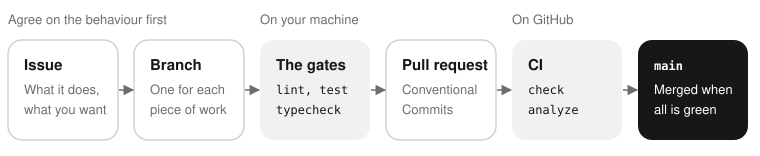

# Contributing to Saldo

Thank you for your interest. [AGENTS.md](AGENTS.md) has the full set of conventions, for persons and for
coding agents. It is the file that we keep up to date. This page is the short version. All persons who
take part follow the [code of conduct](CODE_OF_CONDUCT.md).



## Status

Saldo is a proof of concept. We build it from a written spec, not one feature at a time. The spec and
the roadmap are in [`docs/superpowers/`](docs/superpowers/plans/README.md). Before you change a phase,
read it.

The first screens came from a design prototype that is not in this repository. When the prototype and
the spec are different, **the spec wins**: the prototype used false data and some false behaviour. You
do not need the prototype. The `@saldo/ui` tokens, icons and primitives contain what it defined.

## Getting set up

You need Node 22 (`.nvmrc` sets it) and pnpm 10. The [README](README.md#development) has the full
procedure, with the server and the simulator. The short version:

```bash
pnpm install
pnpm lint        # Biome
pnpm typecheck   # tsc --noEmit in every package
pnpm test        # vitest and jest, per package
```

These three commands are the gates. A change goes in only when all three pass.

> **Caution:** Read the output, not the exit code. `pnpm lint` can exit 0 while Biome shows errors. A
> clean result has **no** `lint/…` lines and no final `× Some errors were emitted while running checks.`
> The line `Checked N files … No fixes applied.` only tells you that Biome fixed nothing automatically. If
> your shell filters the output of these commands, run them without the filter before you trust them.

## The conventions that are not negotiable

- **TypeScript strict** everywhere, with `noUncheckedIndexedAccess` on. No `any`, no non-null
  assertions (`!`).
- **Money is integer minor units.** Never a float in storage or in a calculation. Format money only at
  the edge, with `@saldo/i18n`.
- **Transaction dates are `LocalDate`** (`YYYY-MM-DD`). Never use `new Date(localDate)`. Use the date
  helpers of `@saldo/core`.
- **Business rules are in `@saldo/core`**, as pure functions. Inject the clock, and write the unit tests
  first. Screens and route handlers load data, call core, and show or return the result.
- **No user-visible strings in the code.** Each string has an i18n key in
  `packages/i18n/src/locales/it.ts` *and* in `en.ts`. A parity test makes sure that both exist.
- **No colours, radii or font sizes in the code** of the apps. Use the `@saldo/ui` tokens, and use the
  existing primitives again.
- **`packages/*` never imports from `apps/*`.** `@saldo/core` imports no React, React Native, Node or DOM
  API.
- **The build makes `apps/mobile/android` and `apps/mobile/ios`.** Never commit them. Put native
  configuration in a config plugin.
- **Never commit secrets, keystores or `.env` files.** Commit only `.env.example`.

## Commits and branches

Use [Conventional Commits](https://www.conventionalcommits.org/): `feat(core): …`, `fix(mobile): …`,
`test(web): …`, `docs: …`. Make a branch for each piece of work. Do not commit directly to `main`.
Commit often. A small commit that tells why is better than a large commit that tells what.

## Two numbers that are not yours to change casually

`SYNC_SCHEMA_VERSION` (`packages/core/src/sync/protocol.ts`) stops an old peer from losing rows that it
cannot keep. Increase it when the old code cannot read correctly a row that the new code writes:
a new required field, a field with a changed meaning, a removed field. Do not increase it for a change
that only the UI shows. After an increase, each person must build and install each phone again by hand.
Thus an unnecessary increase costs all persons an evening. A self-hoster reads about it in
**Versions and compatibility** in [Self-hosting Saldo](docs/self-hosting.md).

`apiVersion` in `/api/health` is the same promise for the HTTP API.

## What to open first

Before you open a pull request that changes a behaviour, open an issue. Tell what the app does now, and
what you expected. Choose the **Bug report** or the **Feature request** form: each form asks for what a
reviewer needs. It is easier to agree on the behaviour than to review the wrong fix. If the spec already
decided the question, the answer can be in `docs/superpowers/`.

> **Warning:** For a security problem, do not open an issue. Follow [SECURITY.md](SECURITY.md).
