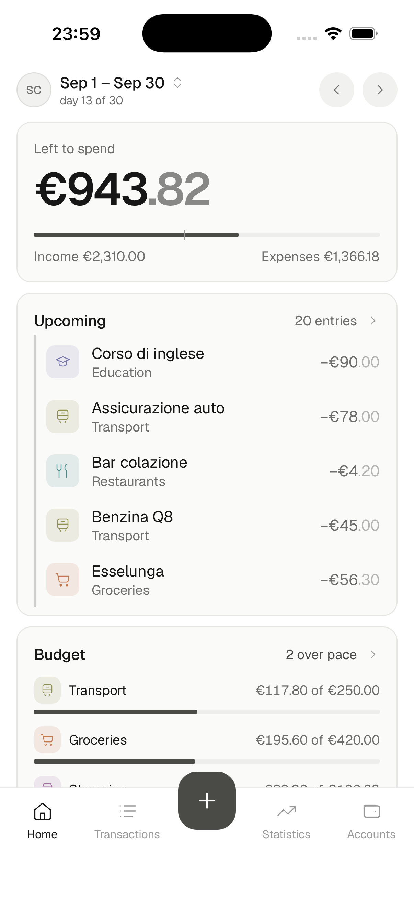
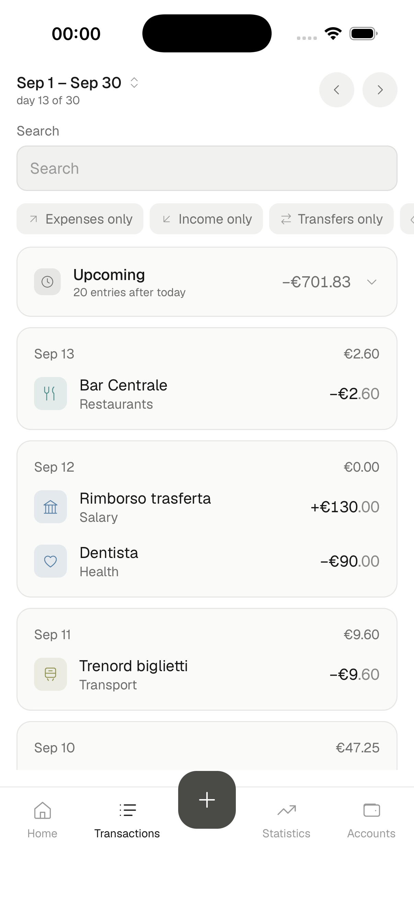
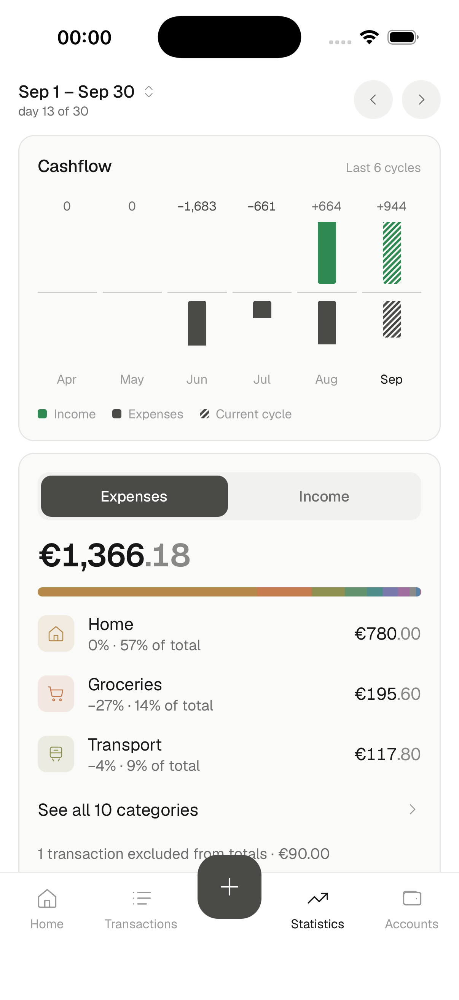
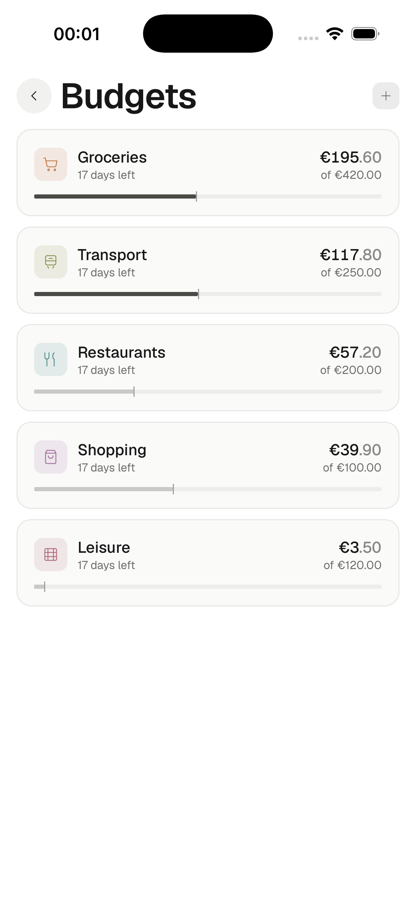
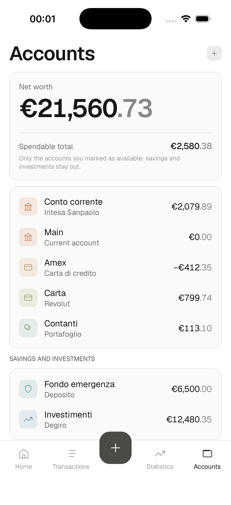
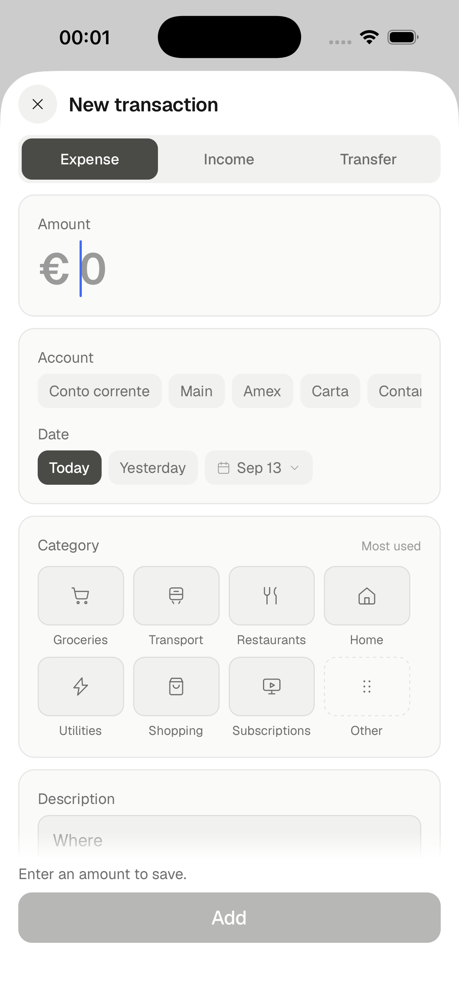

# Saldo

Open-source, local-first personal finance app. Track spending period by period, with budgets and statistics, on your
phone. It works on the phone alone, with no account and no server; or sign in with a passkey to a server you run
yourself, and it syncs across your devices when it can. Build it yourself, sideload it, own your data.

> Status: proof of concept in progress. See the [phase index](docs/superpowers/plans/README.md) for what is
> built and [`ROADMAP.md`](ROADMAP.md) for what comes next.

## Screenshots

| Home | Transactions | Statistics |
| --- | --- | --- |
|  |  |  |

| Budgets | Accounts | Adding a transaction |
| --- | --- | --- |
|  |  |  |

## What it does

**Money in and out.** Expenses, income and transfers between your own accounts. Categories with
sub-categories, tags, notes, and photo or PDF attachments on a transaction. Recurring entries, which
you can edit for one occurrence, for this one and the following, or for all of them.

**Periods you choose.** A calendar month, a week, a pay cycle starting on the day you get paid, a
year, or a range you pick by hand. Home, the transactions list, statistics and budgets all follow the
period you are looking at.

**Budgets.** One or more categories, an amount, a period, an alert at a percentage you set, and
optional rollover so what you did not spend carries into the next period.

**Statistics.** Cashflow over the last six periods, how much of the period was already committed,
an end-of-period projection, and the split by category and by tag with the change against previous
periods.

**Accounts.** As many as you keep, including credit cards, with balances, a sparkline per account and
archiving for the ones you have closed.

**Your data stays yours.** Export everything as JSON, or with the attachments as a ZIP; export
transactions as CSV, for the period or for all of history; restore a backup onto a phone. Import a
CSV from another app, with a preset for Spendee exports, a column mapping for everything else, and
duplicate detection so a second run does not double your history.

**On the phone.** Italian and English, light and dark following the system, a currency you choose,
and a biometric app lock.

**Across your devices.** Optional: sign in with a passkey to your own server, then every device that
signs into the same account converges — offline edits included, merged last-write-wins.

## Quick start

1. **Build the app** yourself — see [docs/building-android.md](docs/building-android.md) or
   [docs/building-ios.md](docs/building-ios.md). Android needs the Android SDK and a keystore you
   generate. **iOS needs a Mac with Xcode**, and on a free Apple ID the app stops opening after seven
   days until you reinstall it — a paid developer account moves that to a year.
2. **Start on the phone.** The first screen offers "Only on this phone": no account, nothing to set
   up, and it works fully offline.
3. **Optionally, add a server** for sync across devices: run it on a machine with an HTTPS domain and
   mint yourself an invite code — see [docs/self-hosting.md](docs/self-hosting.md). Then choose "With
   your Saldo server" on the first screen, or connect it later from Profile → Server and sync without
   losing anything; type its address, and create your account with the invite code and a passkey.

## What it is not

There is no cloud service to sign up to and no account on anybody else's server: if you do not run a
server, the app simply stays on your phone. Nothing is reported anywhere — no telemetry, no analytics, no
crash reporting. The app does not connect to your bank; you enter transactions, or import them from a
CSV. And there is no App Store or Play Store build: you build it and sideload it yourself.

## Repository

| Path | What |
| --- | --- |
| `apps/mobile` | Expo (React Native) app for Android and iOS |
| `apps/web` | Next.js server: API, passkey auth, sync — see [self-hosting](docs/self-hosting.md) |
| `packages/core` | Domain model and calculations (pure TypeScript) |
| `packages/ui` | Design tokens and icon data |
| `packages/i18n` | Italian and English catalogs, formatters |
| `docs/` | Design reference, spec, implementation plans |

## Development

Everything below assumes the repository root as the working directory.

### Requirements

| | |
| --- | --- |
| Node 22 | Pinned in `.nvmrc` |
| pnpm 10 | `corepack enable` if you do not have it |
| Docker | For Postgres and the S3 emulator |
| Xcode 16+ / Android Studio | Only to run the app on a simulator or a device |

**Node 22, not newer.** `better-sqlite3` ships a native module built for that ABI, so under Node 24
or 26 the mobile test suite fails to load it — with an error about `NODE_MODULE_VERSION` that says
nothing about your change. `fnm use` or `nvm use` reads the pin.

```bash
fnm use && node --version   # v22.x
pnpm install
```

### Step 1 — what the server talks to

```bash
docker compose -f apps/web/docker/docker-compose.dev.yml up -d
```

Postgres on 5432 and [Floci](https://github.com/floci-io/floci) on 4566, standing in for S3 with the
attachment bucket created for you. `POSTGRES_PORT` moves the database if something else already
holds that port — match `DATABASE_URL` to it. The server is deliberately *not* in there: it runs from source so a change
reloads without a rebuild.

### Step 2 — the server

```bash
cp apps/web/.env.example apps/web/.env
openssl rand -base64 48        # paste into JWT_SECRET
pnpm --filter web db:migrate
pnpm --filter web dev          # http://localhost:3000
curl -s localhost:3000/api/health
```

Attachments are off by default (`ATTACHMENT_STORAGE=none`), which is a supported way to run: they
stay on the phone. To store them on the server, uncomment either the `fs` line or the `s3` block in
`.env` — the `s3` values are already filled in with what Floci serves.

> If something else is on port 3000, Next starts on 3001 without making a fuss, and the passkey
> ceremony then fails with an opaque WebAuthn error because `PUBLIC_URL` names the wrong origin.
> Free the port, or set `PUBLIC_URL` to the one it picked.

### Step 3 — the app

```bash
cd apps/mobile
npx expo run:ios      # or run:android
```

The app does not know about the server until you tell it: on the welcome screen choose "With your
Saldo server" and type `http://localhost:3000` — `http://10.0.2.2:3000` on the Android emulator. A
bare hostname gets `https://`, so spell out `http://` here; the app accepts plain `http` only for this
machine, never for an address on the network. Or pick "Only on this phone" to work without steps 1
and 2 at all.

Afterwards `npx expo start` is enough for JavaScript changes. Three things need the full rebuild
above: a **new native module**, a change to **`app.config.ts`** (permissions, scheme, bundle id —
they live in `Info.plist`, not in the bundle), and a **new migration** — for which you also delete
the simulator's database, because Metro caches the inlined SQL:

```bash
xcrun simctl get_app_container booted io.github.saldo.app data
rm -f "<that path>/Documents/SQLite/saldo.db"
```

`.env.example` ships `REGISTRATION=invite`. The **first** account needs no code: open the server in a
browser and `/setup` walks you through naming the instance and creating your admin account with a
passkey. Every later account needs a code, which you mint from `/admin` (**Inviti**) or on the server:

```bash
pnpm --filter web invite new --label me
```

Once the app has found the server it offers "Create account"; on a fresh instance that also creates
the first account, with no code, and it becomes the admin. The passkey ceremony needs a platform
authenticator either way: on the simulator, enrol Face ID first (Features → Face ID → Enrolled).

### Step 4 — stop

```bash
docker compose -f apps/web/docker/docker-compose.dev.yml down     # add -v to drop the data
```

### Checks

```bash
pnpm lint        # Biome. Read the output: it can exit 0 while reporting errors
pnpm typecheck   # tsc --noEmit in every package
pnpm test        # vitest and jest, per package
```

Targeted runs: `pnpm --filter @saldo/core test`, `pnpm --filter mobile exec jest src/io`,
`pnpm --filter web exec vitest run src/server/sync`.

The S3 driver has an integration test that runs against Floci when step 1 is up, and skips itself
when it is not — so `pnpm test` is honest either way, and that driver is only really exercised with
the stack running.

Two end-to-end flows live in `apps/mobile/maestro/`: `maestro test apps/mobile/maestro/`, with
[Maestro](https://maestro.mobile.dev) installed and the app already on a device. Each file's header
says which state that device has to be in, because the passkey sign-in is not something a flow can
drive.

### Layout of a change

Business rules go in `packages/core` as pure functions with tests; screens and route handlers load
data, call core, and render. Strings go through `packages/i18n` in both locales, colours and radii
through `packages/ui`. Contributors and coding agents: start with [AGENTS.md](AGENTS.md), which is
the full set.

## Self-hosting

The app does not need a server: it runs on the phone alone, and connecting one is a choice on the
first screen or, later, in Profile → Server and sync. Signed in, it stays local-first — it works
offline and keeps working when the server is down. The server is what gives you multi-device sync
and attachment backup.

See [docs/self-hosting.md](docs/self-hosting.md): one `docker compose` command with
`apps/web/docker/docker-compose.yml` (the deployment file, which builds the server into an image —
not the development one above), plus an HTTPS domain, which passkeys require.

## Security

Found a way to read somebody else's data, or to sign in as them? [SECURITY.md](SECURITY.md) says
where to send it — not to a public issue, since every Saldo server is somebody's own machine and
there is no central instance to patch the problem out from under.

## License

[MIT](LICENSE)
