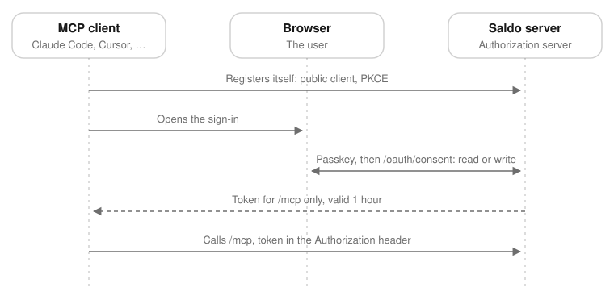

# Security

Saldo keeps the spending history of a person, and it runs the server that authenticates them. Did you
find a way to read the data of a different account? Or to sign in as a different person? Or to make a
server do something that its owner did not ask for? Then please tell us before you tell other persons.

## Reporting a vulnerability

> **Warning:** Do not describe a vulnerability in a public issue. A public issue gives a working attack
> to all persons who run the server. Each Saldo server is the machine of one person, with their money
> data on it. There is no central instance that we can repair for them.

Use the private vulnerability reporting of GitHub:

1. Open the [Security tab](https://github.com/saliougaye/saldo/security/advisories/new) of the
   repository.
2. Choose **Report a vulnerability**.

The report stays private. The report, the fix and the advisory stay in one place.

If the button is not there, open a public issue with the title «Security report» and **no details**. Do
not describe the problem, the route, or a proof of concept. The maintainer answers in the issue, and
gives you a private channel.

In the private report, include what we need to reproduce the problem:

- the version or the commit that you tested;
- how the server is deployed;
- the shortest sequence of requests that shows the problem.

If you have a fix, tell us. But send the report first.

You will get a reply. One person maintains this project in their free time, so a fix can take time. We
will tell you what happens.

## What is in scope

- Reading, writing or deleting the data of a different account.
- Signing in as a different person, or getting a session that nobody gave you: the passkey ceremony,
  the one-time handoff token, the invite codes, the admin role.
- Anything that lets a caller with no sign-in reach data or actions behind `requireUser`.
- Making a server keep, send or delete attachment bytes outside the space of the caller.
- Anything that makes the app talk to a host that is not the server that the user chose.

## What is not

- **Vulnerabilities that need the phone unlocked and in your hands.** The app protects against a look
  over the shoulder (the app lock, the cover in the app switcher). It does not protect against a person
  who holds an unlocked device.
- **A self-hosted server with an unsafe configuration.** For example: no TLS, `REGISTRATION=open` on a
  public address, or a `TRUSTED_PROXIES` that is too wide. [Self-hosting Saldo](docs/self-hosting.md)
  tells you the cost of each. If that documentation is wrong or incomplete, tell us: that is a real bug.
- **Denial of service against your own instance.** One server belongs to one person, with the data of
  one household.
- Missing hardening headers with no consequence that an attacker can use. Results of a scanner that
  nobody reproduced by hand.

## What Saldo already assumes about you

These points set the limits of a report.

**You trust your own server.** The app talks to the server whose address you typed. It follows the
instructions of that server, for example a redirect to presigned storage for an attachment upload. A
dishonest Saldo server can lie to its own users. You give the same trust to each machine that you run
yourself.

**The admin of an instance can reach its database.** Roles and revocation stop a member from
administering the instance. They do not keep the owner out of Postgres. If two persons who do not trust
each other share one server, Saldo does not support that today.

**The admin panel keeps one secret: the SMTP password, if you set one.** The server encrypts it with
`SETTINGS_ENCRYPTION_KEY`, and nobody can read it back in the panel. But the server can decrypt it,
because it must send mail. Thus the person who controls the server and its environment can read it. Use
an SMTP account that can only send mail.

**With SMTP, a person who controls a verified email address of an account can get into that account.**

Without SMTP, there is no recovery. The passkey is the only way in. For a lost passkey, an admin uses
`pnpm --filter web user …`. With SMTP, an account with a verified address can ask at `/recover` for a
link. The link signs a browser in, and the browser then registers a new passkey. Thus the mailbox is as
strong as the passkey: a stolen mailbox is a stolen account. These rules set the limits:

- The server sends a link only to a **verified** address. It never sends one to a revoked account. A
  link from before a revocation stops working. The address that you typed at registration stays
  unverified until you open the verification link.
- The link works one time, the server keeps only its hash, and it is valid 15 minutes. It opens a
  confirmation page that does nothing alone. A mail scanner or a different site that loads the link
  cannot use it or sign a browser in. A person must press «Entra».
- The page, and the time that it takes, do not tell anybody if an address has an account or is verified.
- The server sends to each mailbox a maximum of one message of a type each minute, and five each hour.
  The endpoints also limit the rate of each caller. The two limits apply to each server process.
- Recovery can only sign in an existing account. It never makes an account.

**With SMTP, an account can also change its verified address.** The server sends a link to the new
address. The address changes only when a person opens that link and presses the button. A change does not
sign anybody in. These rules set the limits:

- Each account has a maximum of one pending change. The link works one time, the server keeps only its
  hash, and it is valid 24 hours. A new request replaces it.
- If the old address is verified, the server tells it about the change. The notice shows the new address
  in masked form. It has no link, and the limit for each address does not stop it.
- The answer does not tell anybody if the new address has an account.
- The server checks the link again when a person uses it. If a different account took the address in the
  meantime, the server refuses the change.

What it does **not** stop: a person with a signed-in session of the account can start and finish a
change. Examples are a stolen phone or an open browser. The new mailbox is theirs. The notice to the old address
is the only warning. The owner then asks the admin of the instance to restore the address
(`pnpm --filter web user …`).

If you do not want this risk, do not configure SMTP. Then verification, recovery and the change of
address do not exist, and nothing else changes.

## MCP and connectors

An instance has a [Model Context Protocol](https://modelcontextprotocol.io) endpoint at
`{PUBLIC_URL}/mcp`. An MCP client of a user (Claude Code, the custom connectors of Claude, any MCP client)
reads the data of that user. If the user allows it, the client also changes the data.

These rules set the limits:

- **The only credential is an OAuth 2.1 token that the user gave.** Saldo is its own authorization
  server: the endpoints are under `/api/auth/oauth2/*`, and the issuer is `{PUBLIC_URL}/api/auth`.

  The client registers itself. Only public clients are allowed, with PKCE S256, `https://` or loopback
  redirect URIs, exact match, and one registration each minute for each IP. Then the client sends the
  browser of the user to sign in with a passkey, and to `/oauth/consent`. There, the user chooses what
  the client can do. Nobody pastes or shares a secret, and there are no personal access tokens. A
  registration alone gives no access.
- **What a token is.** An opaque string. The server keeps only its hash, and it checks it in the database
  at each call. It is not a JWT, so a revocation works immediately. Its audience is `{PUBLIC_URL}/mcp`,
  and the server refuses it at all other places. The server accepts it only in the `Authorization`
  header, never in a URL, and it never writes it to a log.
- **What a token is not.** It is not the session of the user. It does not open the web app, change a
  passkey, reach `/admin` or read the rows of a different user. It has no identity claims: no OpenID
  Connect, no id token.
- **Two scopes.** `read` reads what the user sees in the app. `write` also adds and changes
  transactions, accounts, categories, tags, budgets and goals. On the consent page, the user can refuse
  `write`. A `read` token does not see the write tools, and the server refuses a write call without the
  scope.
- **Revocation works immediately.** Profilo › Connettori shows each authorized connector, with its scopes
  and its last use. «Revoca accesso» deletes the consent and all the tokens of that user and client. The
  next call of the client gets a 401.
- **Lifetimes.** An access token is valid one hour. A refresh token exists only when the client asks for
  the technical `offline_access` scope. MCP clients ask for it: the server advertises it, and the consent
  page never shows it. Each use rotates the refresh token. An authorization that has no refresh for 180
  days expires. The session of the phone has the same limit.
- **A write from MCP is the same as a write from the web.** A write tool uses the same server functions
  as the web forms. It uses the same rules from `@saldo/core` and the same limits for each user. It also
  checks for a change that the phone made in the meantime. The client asks the person to confirm a write.
  The server does not ask a second time.
- **The server never calls a model.** The model runs in the client of the user. Saldo keeps no AI
  key. It only answers the calls that it gets.
- **An admin can turn it off** at `/admin/mcp`, or with `MCP_ENABLED=false` in the environment. The
  variable locks the switch. When MCP is off, `/mcp`, the discovery documents, registration and
  authorization answer 404, and the consent page refuses. Thus no client reads or writes anything. Token
  refresh and token revocation continue to work, but `/mcp` still refuses a refreshed token. A connector
  that kept its refresh token works again when MCP is on again.
- The endpoint limits each token to 120 requests each minute, and each body to 1 MB. Like the other
  limiters, the limit applies to each server process.

What it cannot stop: an authorized client can do what its scopes allow. If a client with `write` does
something wrong, it writes something wrong. Give `write` only to a client that you would let type in the
app.

## Supported versions

This is a proof of concept, before its first release. Only the current `main` is supported. There are no
backports. To update, build the server and the app again from the latest commit. See
**Versions and compatibility** in [Self-hosting Saldo](docs/self-hosting.md): it tells you what to do,
and what a phone does in the meantime.
