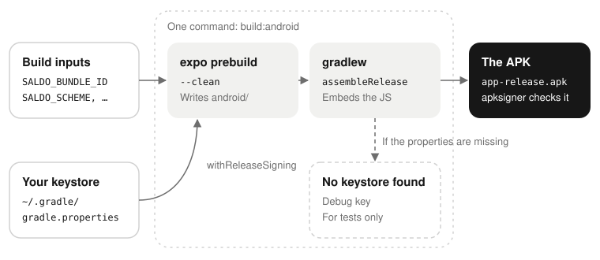

# Building Saldo for Android

## What you get

You get one file, `app-release.apk`, signed with a key that you made. You copy it to a phone and install
it. Saldo is not on the Play Store, and it will not be. Thus you must build it yourself.

The build does not need a server. The app works on the phone alone. It asks for the address of a server
only if you want one: on the first screen, or later in Profile → Server and sync. To run a server, read
[Self-hosting Saldo](./self-hosting.md).



## Before you start

Do these checks before you clone the repository. Here, each failure is easy to read. In the middle of a
Gradle build, it is not.

| Check | A correct answer | An incorrect answer |
| --- | --- | --- |
| `java -version` | `openjdk version "17.0.2"`: any 17.x | `command not found`, or a version before 17. Install a JDK 17 (Temurin, Zulu, or the JDK of Android Studio). |
| `adb --version` | `Android Debug Bridge version 1.0.41` | `command not found`. The Android SDK is missing, or its `platform-tools` directory is not on your `PATH`. |
| `echo $ANDROID_HOME` | The SDK directory, for example `/Users/you/Library/Android/sdk` | Nothing. The build stops with `SDK location not found`. |
| `node --version` | `v22.x`: `.nvmrc` sets the major version | A different major version. Run `nvm use` in the checkout. |
| `pnpm --version` | `10.x` | `command not found`. Run `corepack enable pnpm`. |

The easiest way to get the SDK is Android Studio: install it, and let it install the SDK. After that, you
do not have to open it again. Then add these lines to your shell profile:

```bash
# macOS
export ANDROID_HOME="$HOME/Library/Android/sdk"
# Linux: export ANDROID_HOME="$HOME/Android/Sdk"
export PATH="$ANDROID_HOME/platform-tools:$PATH"
```

## The build inputs

`apps/mobile/app.config.ts` reads three environment variables. It reads them two times: when the build
makes the native project, and when Gradle adds the JavaScript. Put the variables in front of the build
command, so that the two readings see them. None of them is a server address: you type that in the app.

| Variable | Default | What it is |
| --- | --- | --- |
| `SALDO_APP_NAME` | `Saldo` | The name under the launcher icon. |
| `SALDO_BUNDLE_ID` | `io.github.saldo.app` | The Android application id. **A fork must change it.** It is the identity of the app on the device, and two apps cannot have the same id. Use the form `com.example.saldo`. |
| `SALDO_SCHEME` | `saldo` | The URL scheme that brings the sign-in back from the browser to the app. The app asks to come back to `<scheme>://auth/callback`. **If you change it, change the server too:** the server refuses a scheme that is not in its `APP_REDIRECT_SCHEMES` (see [Configuration](./self-hosting.md#configuration)), and the sign-in fails with `invalid_redirect_uri`. Change it when a different app on the same phone uses `saldo://`. |

## Make a keystore

Android knows an app by the key that signed it. Thus you need your own key. Make it one time, and keep it
out of the checkout:

```bash
mkdir -p ~/keys && cd ~/keys
keytool -genkeypair -v -storetype PKCS12 -keystore saldo-release.keystore \
  -alias saldo -keyalg RSA -keysize 2048 -validity 10000
```

`keytool` asks for a password two times. Then it asks for a name, an organisation and a country. These
fields are not important for an app that nobody publishes. But you see the name when you check the
signature later, so type a name that you know. A PKCS12 keystore has **one** password: `keytool` does not
ask for a separate key password. The store password is also the key password.

> **Warning:** Back up the keystore file and its password. Do not lose them. Android refuses an APK
> signed with a different key as an update of an installed app. Without the key, each person who has
> Saldo must uninstall it and install it again. That deletes all the data that was not synced to a
> server. On a phone without a server, that is all the data.

## Tell Gradle about it

Gradle finds the keystore through four properties in `~/.gradle/gradle.properties`. If the file does not
exist, make it:

```properties
SALDO_UPLOAD_STORE_FILE=/Users/you/keys/saldo-release.keystore
SALDO_UPLOAD_STORE_PASSWORD=the password you just typed
SALDO_UPLOAD_KEY_ALIAS=saldo
SALDO_UPLOAD_KEY_PASSWORD=the same password again
```

Use an absolute path. The properties are in your home directory, not in the repository, for two reasons:

- Each build deletes and makes again `apps/mobile/android/`, and git ignores it. A change that you make
  there by hand is gone at the next build.
- A password in a git checkout can be pushed by accident.

A config plugin, `apps/mobile/plugins/withReleaseSigning.js`, reads the four properties. It sets
`signingConfigs.release` each time the build makes the project again.

If the plugin does not find the properties, the build still finishes. A machine with no keystore (CI, or
a person who only checks that the app compiles) must be able to run `assembleRelease`. But the APK is then
signed with the debug key, and the build tells you:

```
Saldo: no SALDO_UPLOAD_STORE_FILE property, so this release build is signed with the shared
Android debug key. It is fine for testing and must not be given to anyone.
```

That line is easy to miss in the output of Gradle. Before you give the APK to a different person, check
the signature: see [Check that it is really signed](#check-that-it-is-really-signed).

## Build it

1. Get the code, and install the dependencies:

   ```bash
   git clone https://github.com/saliougaye/saldo.git
   cd saldo
   pnpm install
   ```

2. Optional: see the values that the build will use, without a build. The build takes minutes, and it
   starts by deleting `android/`:

   ```bash
   SALDO_DRY_RUN=1 pnpm --filter mobile build:android com.example.saldo
   ```

3. Build:

   ```bash
   pnpm --filter mobile build:android com.example.saldo
   ```

The argument is the bundle identifier. If you use the identifier of this project, you can leave it out.
`SALDO_BUNDLE_ID=…` in front of the command does the same.

The script does two things:

1. `expo prebuild --platform android --clean` makes the native project again, with your variables.
2. `./gradlew assembleRelease` compiles it.

At the end, the script asks `apksigner` which key signed the APK. It tells you clearly if the key is
yours. The first build downloads Gradle and compiles all the native modules: it needs a network
connection and about 15 minutes. Later builds are much faster.

> **Caution:** Put the variables on the same line as the command, in front of it. `app.config.ts` is read
> **two times**: by the prebuild, and by Gradle when it adds the JavaScript bundle. The sign-in scheme
> comes from the second reading. Do not export the variables in one terminal and build in a different
> one. Do not set them only for the prebuild. If you do, the sign-in goes to a scheme that the app does not
> have. The
> script exports the variables for the two steps.

The APK is here:

```
apps/mobile/android/app/build/outputs/apk/release/app-release.apk
```

## Check that it is really signed

The build script does this check and shows the result. Do it yourself to check an APK from a different
person, or when the script could not do it because `ANDROID_HOME` was not set.

`apksigner` is not on your `PATH`. It is in the build tools of the SDK. Use its full path, with the
newest version that you have:

```bash
"$ANDROID_HOME"/build-tools/36.0.0/apksigner verify --print-certs \
  apps/mobile/android/app/build/outputs/apk/release/app-release.apk
```

The result names the certificate that you made:

```
Signer #1 certificate DN: CN=Saldo, OU=, O=, L=, ST=, C=IT
Signer #1 certificate SHA-256 digest: f7da5723d0690488e8e37029585675dfb0c6c5f97bf3b77d8af1220c359b5e88
```

If you see the next line, the build used the debug key of the React Native template. All machines in the
world have that key, with the same public password:

```
Signer #1 certificate DN: CN=Android Debug, OU=Android, O=Unknown, L=Unknown, ST=Unknown, C=US
```

This means that Gradle did not find your four `SALDO_UPLOAD_*` properties. The build told you during the
build. Do not give that APK to anybody: see [When it goes wrong](#when-it-goes-wrong).

`keytool -printcert -jarfile` answers «Not a signed jar file» here. The APK is correct. The build signs
with APK Signature Scheme v2, and it does not add the older JAR signature that `keytool` reads.
`apksigner verify -v` shows `v2 scheme … true` and `v1 scheme (JAR signing) … false`.

## Install it

**With a cable:**

1. On the phone, turn on USB debugging (Settings → Developer options).
2. Connect the phone.
3. Install the APK:

   ```bash
   adb install -r apps/mobile/android/app/build/outputs/apk/release/app-release.apk
   ```

`-r` replaces an installed Saldo and keeps its data. This works only when the same key signed the old
APK.

**Without a cable:**

1. Copy the APK to the phone.
2. Open it in the file manager of the phone.
3. The first time, Android refuses and shows a settings screen. Let the file manager (or the browser)
   install unknown apps.
4. Open the APK again.

To find this setting later, open Settings → Apps → Special app access → Install unknown apps.

Then open Saldo. The first screen shows «Only on this phone» and «With your Saldo server». The second
choice asks for the address of the server, then shows the sign-in. If the server uses
`REGISTRATION=invite`, you need a code first: see [Letting people in](./self-hosting.md#letting-people-in).

## When it goes wrong

**`SDK location not found. Define a valid SDK location with an ANDROID_HOME environment variable.`**
`ANDROID_HOME` is not set in the shell of the build. Export it (see [Before you start](#before-you-start)),
and build again.

**The build finished, but `apksigner` shows `CN=Android Debug`.** Gradle did not see your properties.
Thus it used the debug key, and it showed the warning above. The fallback looks only at
`SALDO_UPLOAD_STORE_FILE`, so a typing error in that name is the most probable cause. Make sure that:

- the four properties are in `~/.gradle/gradle.properties`, in your home directory, not in the
  repository;
- no name has a typing error;
- `SALDO_UPLOAD_STORE_FILE` is an absolute path to a file that exists.

To see if Gradle loaded the property, run this command in `apps/mobile/android`:

```bash
./gradlew -q :app:properties | grep SALDO_UPLOAD_STORE_FILE
```

> **Warning:** Search for that one name only, not for the full prefix. The task shows the values of the
> properties, and the other three are your passwords.

**`INSTALL_FAILED_UPDATE_INCOMPATIBLE`, or «App not installed» on the phone.** Saldo is already installed
with this application id, but a different key signed it. This is often a debug build, or an APK from a
machine whose keystore you do not have now. To continue, you must uninstall the app first
(`adb uninstall io.github.saldo.app`).

> **Warning:** Uninstalling deletes the local database. The data that did not get to a server is lost.
> On a phone without a server, that is all the data. If the phone is signed in and finished its sync, you
> lose nothing.

**`Failed to read key saldo from store …: keystore password was incorrect`.** In a PKCS12 keystore, the
store password and the key password are the same. Set the two properties to it. To check the password,
run `keytool -list -keystore ~/keys/saldo-release.keystore`.

**The build fails in `:app:` after you changed a file in `apps/mobile/android/`.** The build makes that
directory, and each build starts by deleting it. Make your change in `app.config.ts`, or in a config
plugin in `apps/mobile/plugins/`.
