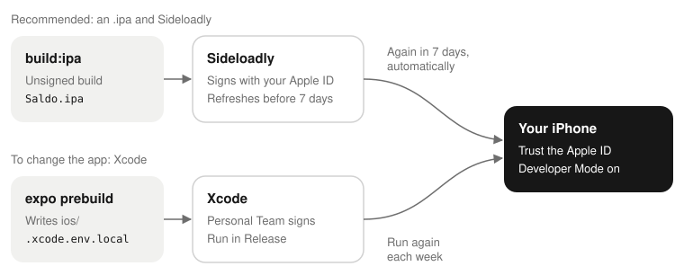

# Building Saldo for iOS

## What you get

You get Saldo on your own iPhone, built from this repository. Saldo is not on the App Store. Thus this
is the only way.

> **Caution:** Read this before you start. Apple lets you install an app that you built, but with a free
> Apple ID, there are limits:
>
> - The app **stops working after seven days**. To start the seven days again, connect the phone and run
>   the app from Xcode again. A tool can do this for you: see below.
> - You can install a maximum of **three** self-signed apps at the same time.
> - You need a Mac. There is no other way.

A paid Apple Developer account (99 USD each year) changes seven days to one year, and three apps to one
hundred. Nothing else changes: you still build and install the app yourself.

**The recommended way to install it is [Sideloadly](https://sideloadly.io).** One command builds an
`.ipa`. Sideloadly signs it with your Apple ID when it installs it, so you do not use the signing screens
of Xcode. With its automatic refresh on, Sideloadly signs the app again before the seven days end. See
[Building an .ipa for a sideload tool](#building-an-ipa-for-a-sideload-tool). The Xcode procedure in the
rest of this page is for when you change the app.



The build does not need a server. The app works on the phone alone. It asks for the address of a server
only if you want one: on the first screen, or later in Profile → Server and sync. To run a server, read
[Self-hosting Saldo](./self-hosting.md).

## Before you start

| Check | A correct answer | An incorrect answer |
| --- | --- | --- |
| `sw_vers -productName` | `macOS` | Any other answer: you can sign iOS apps only on a Mac. |
| `xcodebuild -version` | `Xcode 26.x`, or the current version | `command not found`, or the licence prompt. Install Xcode from the App Store, open it one time, and accept the licence. |
| `pod --version` | `1.16.x` or later | `command not found`. Run `brew install cocoapods` or `sudo gem install cocoapods`. |
| `node --version` | `v22.x`: `.nvmrc` sets the major version | A different major version. Run `nvm use` in the checkout. |
| `pnpm --version` | `10.x` | `command not found`. Run `corepack enable pnpm`. |

You also need an Apple ID in Xcode: Xcode → Settings → Accounts → **+** → Apple ID. A free Apple ID is
sufficient. When you sign in there, Xcode makes the «Personal Team» that you choose later.

## The build inputs

`apps/mobile/app.config.ts` reads three environment variables. It reads them two times: when you make the
Xcode project, and when Xcode adds the JavaScript. The two readings are important. The second reading
occurs in Xcode, and Xcode does not get the environment of your shell. A step below solves this. None of
the variables is a server address: you type that in the app.

| Variable | Default | What it is |
| --- | --- | --- |
| `SALDO_BUNDLE_ID` | `io.github.saldo.app` | The bundle identifier. **You must change it**: see below. |
| `SALDO_APP_NAME` | `Saldo` | The name under the home-screen icon, and the name of the Xcode project. |
| `SALDO_SCHEME` | `saldo` | The URL scheme that brings the sign-in back from the browser to the app. The app asks to come back to `<scheme>://auth/callback`. **If you change it, change the server too:** the server refuses a scheme that is not in its `APP_REDIRECT_SCHEMES` (see [Configuration](./self-hosting.md#configuration)), and the sign-in fails with `invalid_redirect_uri`. Change it when a different app on the same phone uses `saldo://`. |

## Generate the Xcode project

1. Get the code, and install the dependencies:

   ```bash
   git clone https://github.com/saliougaye/saldo.git
   cd saldo
   pnpm install
   ```

2. Make the Xcode project, with your own bundle identifier:

   ```bash
   SALDO_BUNDLE_ID=com.example.saldo \
     pnpm --filter mobile exec expo prebuild --platform ios --clean
   ```

Replace `com.example.saldo` with an identifier of yours: a reversed domain, or
`com.<your-apple-id-name>.saldo`.

> **Caution:** **The default `io.github.saldo.app` does not sign.** A free Personal Team can use only
> identifiers that nobody registered. This project has that identifier.

The command writes `apps/mobile/ios/` and runs `pod install` in it. The first time, it takes some minutes.
Git ignores the directory, and `--clean` deletes and writes it again at each run. Do not keep files of
yours in it.

## Hand the variables to Xcode

Xcode does not get the environment of your terminal. But it needs the same variables when it adds the
JavaScript. Without them, the bundle uses the default values. With your own `SALDO_SCHEME`, the sign-in
then goes to a scheme that the app does not have.

The build phase that adds the JavaScript first reads `apps/mobile/ios/.xcode.env.local`. Add the
variables to that file:

```bash
cat >> apps/mobile/ios/.xcode.env.local <<'EOF'
export SALDO_BUNDLE_ID=com.example.saldo
EOF
```

Add to the file; do not replace it. The file can contain a `NODE_BINARY` line from the prebuild, and
Xcode needs that line to find Node. Git ignores the file, and `--clean` deletes it with the rest of
`ios/`. Thus you must do this step again each time that you make the project again.

## Sign it

1. Open the **workspace**, not the project. Only the workspace knows the pods:

   ```bash
   open apps/mobile/ios/Saldo.xcworkspace
   ```

   Its name comes from `SALDO_APP_NAME`. Thus it is `Saldo.xcworkspace`, unless you changed that.
2. In Xcode, select the **Saldo** target in the left sidebar.
3. Open **Signing & Capabilities**.
4. Select **Automatically manage signing**.
5. In the **Team** list, choose your name followed by «(Personal Team)».
6. Make sure that the bundle identifier is the one that you used for the prebuild.

Xcode registers the identifier and makes a provisioning profile. If it shows a red error here, read
[When it goes wrong](#when-it-goes-wrong) before you change anything.

## Run it on the phone

The default Xcode scheme builds Debug. Debug needs a Metro bundler on your Mac to start. Use Release: it
puts the JavaScript in the app, and then the app needs nothing more.

1. **Product → Scheme → Edit Scheme… → Run → Info → Build Configuration → Release.** Close the sheet.
2. Connect the phone, unlock it, and trust the Mac if it asks.
3. On the phone, turn on **Settings → Privacy & Security → Developer Mode**. Restart the phone when iOS
   asks. The switch appears only after a Mac tried to install an app. If you cannot find it, do the next
   step, then come back.
4. Choose the phone in the device menu at the top of the Xcode window, next to the scheme.
5. Click **Run** (⌘R).

The first start probably stops with «Untrusted Developer». iOS does not run an app from an account that
it does not know. To trust the account:

1. On the phone, open **Settings → General → VPN & Device Management**.
2. Tap your Apple ID under «Developer App», and trust it.
3. Open Saldo from the home screen.

The first screen shows «Only on this phone» and «With your Saldo server». The second choice asks for the
address of the server, then shows the sign-in. If the server uses `REGISTRATION=invite`, you need a code
first: see [Letting people in](./self-hosting.md#letting-people-in).

## Keeping it alive

With a free Apple ID, the provisioning profile expires after seven days. Then the app does not open until
the profile is renewed. Use one of these ways:

- **Install with [Sideloadly](https://sideloadly.io), and turn on its automatic refresh
  (recommended).** Its background service signs the app again before it expires, when it can see the
  phone: over USB, or over Wi-Fi after you set up Wi-Fi sideloading. The computer with Sideloadly must
  be on. If the phone stays away from it for a week, the app still expires.
- Connect the phone, and click Run in Xcode again, one time each week. You lose nothing: the data of the
  app stays on the phone when you install again, if the bundle identifier is the same.
- [AltStore](https://altstore.io) and [SideStore](https://sidestore.io) do the same job as Sideloadly,
  and they also refresh in the background. AltStore uses a helper on your Mac. SideStore works from the
  device.

A paid developer account changes the expiry to one year.

## Building an .ipa for a sideload tool

These tools need an `.ipa`. A free Apple ID cannot export one with Archive → Distribute in Xcode. This is
not a problem: the tools sign the app themselves when they install it. Thus they need an **unsigned**
build, which is a usual `xcodebuild` and a zip.

1. Optional: see the values that the build will use, without a build. The build takes minutes, and
   `--clean` deletes `ios/` before it starts:

   ```bash
   SALDO_DRY_RUN=1 pnpm --filter mobile build:ipa com.yourname.saldo
   ```

2. Build:

   ```bash
   pnpm --filter mobile build:ipa com.yourname.saldo
   ```

The argument is optional. The default is the bundle identifier of this project. Use your own if the tool
refuses to sign the default. `SALDO_BUNDLE_ID` as an environment variable does the same.
`SALDO_APP_NAME` and `SALDO_SCHEME` also work.

The file is `apps/mobile/build/Saldo.ipa`. To install it with Sideloadly:

1. Connect the phone, unlock it, and choose it as the device in Sideloadly.
2. Drag the `.ipa` into Sideloadly, and type your Apple ID.
3. Turn on **automatic refresh**, so that Sideloadly signs the app again before the seven days end.
4. Click **Start**.
5. On the phone, turn on **Settings → Privacy & Security → Developer Mode** if iOS asks (iOS 16 and
   later).
6. Trust your Apple ID in **Settings → General → VPN & Device Management**.
7. Open Saldo from the home screen.

To update the app later, build a new `.ipa`, and install it in the same way. Use the same Apple ID and
the same bundle identifier. The new app replaces the old one, and the data on the phone stays.

Sideloadly can change the bundle identifier when it installs the app. You can accept this. The `saldo://`
scheme of the sign-in is in `Info.plist`, and it does not depend on the identifier. Do not change the
scheme itself, unless you also change `APP_REDIRECT_SCHEMES` on the server: see
[The build inputs](#the-build-inputs).

The script is `apps/mobile/scripts/build-ipa.sh`. It is short: you can read it, and do the steps
yourself.

## When it goes wrong

**«Failed to register bundle identifier. The app identifier … is not available.»** A different person
has the identifier: `io.github.saldo.app` is certainly taken. Run the prebuild again with a different
`SALDO_BUNDLE_ID`. A change only in Xcode is not sufficient: the next `--clean` puts the old identifier
back, because the project comes from `app.config.ts`.

**«Untrusted Developer» when the app starts.** On the phone, open Settings → General → VPN & Device
Management, tap your Apple ID, and trust it. Do this one time for each Apple ID, not for each install.

**«No account for team …» or «Your maximum App ID limit has been reached».** A free Apple ID can register
ten identifiers each seven days. Each test identifier uses one. Choose your identifier before you try
other things.

**There is no `Saldo.xcworkspace`, only `Saldo.xcodeproj`.** CocoaPods writes the workspace at the end of
the prebuild. If it is missing, `pod install` did not finish. When it finishes, the prebuild shows
`✔ Installed CocoaPods`. Run the prebuild again, and read its output. Do not open the `.xcodeproj`: it does
not know the pods, and it does not build.

**You changed a file in `apps/mobile/ios/`, and the change is gone.** The prebuild makes that directory,
and `--clean` deletes it. Put native configuration in `app.config.ts`, or in a config plugin in
`apps/mobile/plugins/`.
