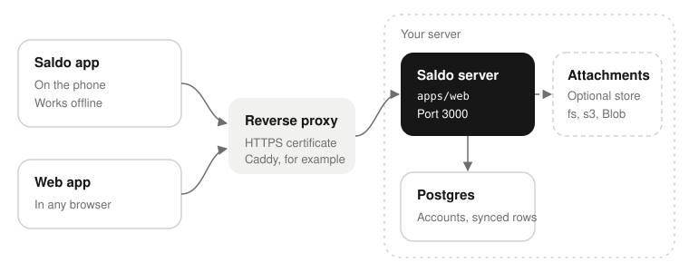
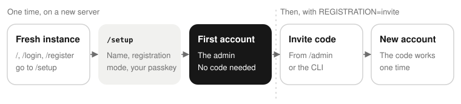
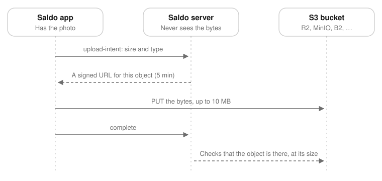
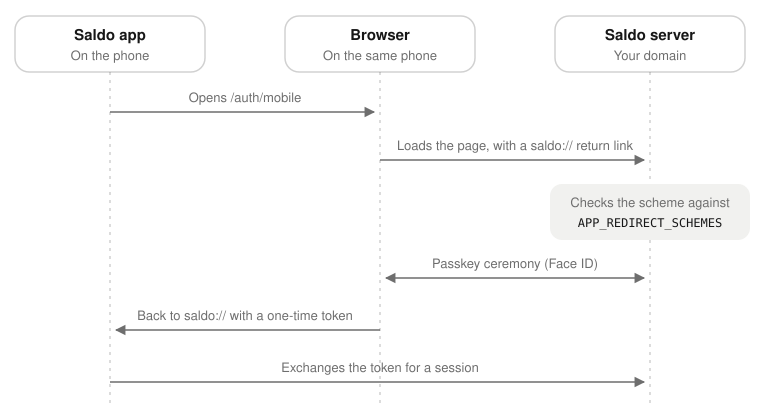

# Self-hosting Saldo

The Saldo server (`apps/web`) keeps the accounts. The app does not need a server: it works on the phone
alone, with no account. The server adds two things: sync between devices, and a backup of attachments.
With an account, the app stays local-first. It works offline, and it continues to work when the server
is down.



The app is not built for one server. On its first screen («With your Saldo server»), the app **asks for
the address**. This is the HTTPS address of Saldo in a browser, for example `saldo.example.com`. You can
also change it later, in Profile → Server and sync. The app checks `/api/health` at that address before
it shows the sign-in.

The server must know one thing about the app: its URL scheme. Put the scheme in `APP_REDIRECT_SCHEMES`.
The scheme is `saldo`, unless the app was built with a different `SALDO_SCHEME`. To build the app, read
[Building Saldo for Android](./building-android.md) or [Building Saldo for iOS](./building-ios.md).

## What you need

- A machine with Docker. You can also run the server directly, with Node 22 and Postgres 17.
- **A domain on HTTPS.** Passkeys (WebAuthn) work only in a secure context, so this is a requirement.
  Browsers make one exception: `http://localhost`. For this reason, local development works without a
  certificate.
- **HTTPS also for «Install» and «Add to Home Screen».** Browsers register the service worker only on
  HTTPS. You do not configure anything: the manifest uses the instance name, and the Docker image
  contains the icons. The service worker keeps only an «you are offline» page. The web app needs the
  server for all other pages, and it keeps no data in a cache.

## Configuration

| Variable | Example | Purpose |
| --- | --- | --- |
| `PUBLIC_URL` | `https://saldo.example.com` | The origin for WebAuthn and for links. Use `https`, or `http://localhost` for development. |
| `WEBAUTHN_RP_ID` | `saldo.example.com` | The relying party id: the **registrable domain** of `PUBLIC_URL`. No scheme, no port, no path. |
| `WEBAUTHN_RP_NAME` | `Saldo` | The name that the passkey prompt shows. |
| `JWT_SECRET` | 32+ random bytes, base64 | Signs the access tokens. Make one with `openssl rand -base64 48`. |
| `DATABASE_URL` | `postgres://saldo:…@postgres:5432/saldo` | The Postgres database. |
| `STORAGE_DIR` | `/data/attachments` | The directory for attachment files, with `ATTACHMENT_STORAGE=fs`. |
| `SETTINGS_ENCRYPTION_KEY` | 32 random bytes, base64 | **Required.** Encrypts the secrets of the admin panel (today, the SMTP password). Make one with `openssl rand -base64 32`. Keep it: see [Server settings](#server-settings). |
| `REGISTRATION` | `invite` | Optional. `open`, `closed`, `invite` (an account needs a code) or `first-user`. **The first account is always allowed, in all modes**: a new instance opens on `/setup`, a short wizard that makes it. When you set the variable, it locks the choice in `/admin/settings`. When you do not set it, the wizard asks, and you can change it there later. The default is `first-user`. |
| `INSTANCE_NAME` | `Casa Rossi` | Optional, 1–60 characters. The name on the sign-in page and in invites. When you set it, it locks the field in `/admin/settings`. When you do not set it, you choose the name there. The default is `WEBAUTHN_RP_NAME`. |
| `SMTP_HOST`, `SMTP_PORT`, `SMTP_USER`, `SMTP_PASSWORD`, `SMTP_FROM` | `smtp.example.com`, `587` | Optional outgoing mail. When `SMTP_HOST` is set, all the group comes from the environment, and the panel locks it. Then `SMTP_FROM` is required, `SMTP_PORT` is 587 by default, and you set `SMTP_USER` and `SMTP_PASSWORD` together or not at all. |
| `APP_REDIRECT_SCHEMES` | `saldo` | The URL schemes that a mobile redirect can use, separated by commas. Include each `SALDO_SCHEME` of your app builds (the default is `saldo`). If a scheme is missing, each mobile sign-in stops with `invalid_redirect_uri`. |
| `TRUSTED_PROXIES` | `172.28.0.0/16` | The IPs or CIDRs of the reverse proxy in front of this server, separated by commas. Required when a proxy such as Caddy is in front. See [Security notes](#security-notes). |
| `DEFAULT_TIME_ZONE` | `Europe/Rome` | Optional, the default is `UTC`. The time zone for «today» in the web app, for a user who has no time zone in the settings. Each phone sets its time zone at onboarding, so this applies only to older accounts. Do not use `TZ`: Vercel keeps that name. |
| `MCP_ENABLED` | `false` | Optional, `true` or `false`. When you set it, it locks the switch in `/admin/mcp`. When you do not set it, the admin chooses there (the default is on). See [Connecting an MCP client](#connecting-an-mcp-client). |

Read these points before you start:

- **When you change `WEBAUTHN_RP_ID`, all existing passkeys stop working.** A passkey works only for the
  relying party that made it. Choose the hostname that you will keep.
- **Keep `SETTINGS_ENCRYPTION_KEY` with your other secrets.** Without it, the server does not start.
  The key is not in the database, and not in a backup of the database. To know what a lost key costs,
  see [Server settings](#server-settings).
- Use `REGISTRATION=invite`. After your account exists, a new account needs a single-use code. Thus a
  stranger who finds your URL cannot register. The one exception is the **first** account: a new instance
  accepts the first person who opens `/setup`. Thus, open `/setup` immediately after the server starts.
  With `open`, all persons who can reach the server can make an account.

## Run it with Docker

1. Get the code:

   ```bash
   git clone https://github.com/saliougaye/saldo.git
   cd saldo
   ```

2. Set the variables, and start the stack:

   ```bash
   export PUBLIC_URL=https://saldo.example.com
   export WEBAUTHN_RP_ID=saldo.example.com
   export JWT_SECRET="$(openssl rand -base64 48)"
   export SETTINGS_ENCRYPTION_KEY="$(openssl rand -base64 32)"
   export POSTGRES_PASSWORD="$(openssl rand -base64 24)"

   docker compose -f apps/web/docker/docker-compose.yml up -d --build
   ```

3. Keep `JWT_SECRET`, `SETTINGS_ENCRYPTION_KEY` and `POSTGRES_PASSWORD` in a password manager. Docker
   Compose needs the same values each time that you start the stack.

4. Put a reverse proxy in front of the container, for HTTPS. `apps/web/docker/Caddyfile.example` is a
   Caddy configuration of two lines. Caddy gets and renews the certificate automatically.

When the container starts, it applies the database migrations. Then it serves on port 3000. If port 3000
is not free on the host, set `WEB_PORT`:

```bash
WEB_PORT=3007 docker compose -f apps/web/docker/docker-compose.yml up -d
```

## Run it on Vercel instead

You can also deploy the server on Vercel. The server is a usual Next.js app in a pnpm workspace, and
Vercel deploys it as a monorepo. The **Root Directory of the project is `apps/web`**, where `next` is a
dependency. `vercel.json` at the repository root has the install and build commands. If the Root
Directory is the repository root, the build stops with «No Next.js version detected», because the root
`package.json` does not depend on `next`.

> Nobody has done all of this procedure yet. The Docker procedure is tested; this procedure comes from
> what the code does. If a step is wrong, please report it as a bug.

Four things are different from the compose file. Three of them cause failures if you forget them:

- **Use your own Postgres.** The database of the compose file is local to the compose file. Use a
  managed database (Neon, Supabase, Vercel Postgres), and set `DATABASE_URL` to it.
- **Run the migrations yourself.** The build command does not run them, because previews also build. A
  preview with the production database would apply its migrations to it. Run the migrations from your
  machine before the first deploy, and again for each deploy that adds a migration:

  ```bash
  DATABASE_URL='postgres://…' pnpm --filter web db:migrate
  ```

- **Do not use `ATTACHMENT_STORAGE=fs`.** Vercel deletes its filesystem at each deploy. Use `none`
  (attachments stay on the phone), `s3`, or `vercel-blob`. Before you use `vercel-blob`, read the
  caution in [Attachments](#attachments).
- **`PUBLIC_URL` and `WEBAUTHN_RP_ID` must name the production domain**, not a preview URL. A passkey works
  only on the domain that made it. A passkey made on a preview URL does not work on the real domain, and
  the WebAuthn error does not tell you the cause.

### Step by step

> **Caution:** Choose the domain first. A passkey works only on the domain that made it. An account made
> on `saldo-abc123.vercel.app` cannot sign in later on `saldo.example.com`: the browser does not show
> the passkey, and no message tells you why. Do not make an account before the domain is in place.

1. **Make the database.** Use Neon, Supabase or Vercel Postgres. Copy its connection string.
2. **Run the migrations from your machine**, with that connection string. Nothing else makes the tables:

   ```bash
   DATABASE_URL='postgres://…' pnpm --filter web db:migrate
   ```

3. **Make the project. Set its Root Directory to `apps/web`.** Both settings of this step and the next
   are in Settings → Build and Deployment → Root Directory.
4. **Turn on «Include files outside the root directory in the Build Step».** This setting is required.
   Without it, the build sees only `apps/web`: pnpm finds no lockfile, and `packages/*` is not there.

   From the CLI, run all commands from the **repository root**, not from `apps/web`. The CLI applies the
   Root Directory itself:

   ```bash
   vercel link
   vercel project update --root-directory apps/web
   ```

   `project update` has no option for «Include files outside the root directory». Turn it on in the
   dashboard.

   A deploy from your machine (`vercel --prod`) sends your working tree, not a clone. The `.vercelignore`
   at the root decides which files go. Without it, the upload includes the generated `ios/` and
   `android/` projects, and all local `.env` files. It also keeps `turbo.json` out: the deploy does not
   use Turborepo, and with that file the build breaks. Do not delete `turbo.json` from the repository:
   `pnpm typecheck` and `pnpm test` use it.
5. **Add the environment variables** of the next section, for **Production**. `PUBLIC_URL` and
   `WEBAUTHN_RP_ID` name the domain that you chose, not the URL that Vercel makes.
6. **Add the domain** in the Domains tab of the project. Wait for its certificate. Passkeys need HTTPS.
7. **Deploy.** Then make sure that the server answers:

   ```bash
   curl -s https://saldo.example.com/api/health
   ```

   With `REGISTRATION=invite`, `registrationAllowed` and `inviteRequired` are both `true`.
   `schemaVersion` is the number that the app must match.
8. **Make your own invite code.** With `invite`, each account needs a code, also yours. There is no shell
   on the server, so run the command from your machine, against the production database:

   ```bash
   DATABASE_URL='postgres://…' pnpm --filter web invite new --label me
   ```

   The command shows the code one time. The first account that registers is the admin of the instance.

   This command and the migration command read `apps/web/.env`, if you have one for development. A
   variable on the command line wins over the file, so the commands use the production database. Make
   sure of this: an invite in the wrong database is a code that never works, and no error tells you.
9. **Build the app**, and install it. See [Android](building-android.md) or [iOS](building-ios.md):

   ```bash
   pnpm --filter mobile build:android com.example.saldo
   ```

   On the first screen, choose «With your Saldo server». Type `saldo.example.com`: the domain, not a
   preview URL.
10. **Sign in.** The app opens your `/auth/mobile` page in a browser, and the passkey ceremony runs there.
    Then the browser goes back to the app with the `saldo://` scheme. If the sign-in stops, compare
    `APP_REDIRECT_SCHEMES` on the server with the `SALDO_SCHEME` of the app build.

### The environment variables Vercel needs

Set these variables in **Environment Variables** of the project, or with
`vercel env add <NAME> production`.

> **Warning:** Do not put these variables in `vercel.json`. That file is in the repository, and its
> `env` field keeps the values as text. A secret in that file is a public secret.

| Variable | Value | Notes |
| --- | --- | --- |
| `PUBLIC_URL` | `https://saldo.example.com` | Your production domain. Not a preview URL. |
| `WEBAUTHN_RP_ID` | `saldo.example.com` | The registrable domain: no scheme, no port. Passkeys work only for it. |
| `WEBAUTHN_RP_NAME` | `Saldo` | The name of your instance in the passkey prompt. |
| `JWT_SECRET` | `openssl rand -base64 48` | **Secret.** |
| `DATABASE_URL` | `postgres://…` | **Secret.** Your managed Postgres, not the compose database. |
| `ATTACHMENT_STORAGE` | `none`, `s3` or `vercel-blob` | Never `fs` on Vercel. |
| `SETTINGS_ENCRYPTION_KEY` | `openssl rand -base64 32` | **Secret**, and **required**. Keep it: see [Server settings](#server-settings). |
| `REGISTRATION` | `invite` | An account needs a code. The first account is the exception: `/setup` makes it. Optional: when not set, `/admin/settings` decides. |
| `APP_REDIRECT_SCHEMES` | `saldo` | Must match the `SALDO_SCHEME` of the app build. |
| `TRUSTED_PROXIES` | — | Keep it empty until you know what Vercel sends. See the next list. |
| `DEFAULT_TIME_ZONE` | `Europe/Rome` | Optional. Vercel does not let you set `TZ`; Saldo reads this variable. |

Also set the variables of your storage driver. For `vercel-blob`, Vercel adds `BLOB_READ_WRITE_TOKEN`.
For `s3`, see [Attachments](#attachments).

`WEB_PORT`, `POSTGRES_PORT` and `STORAGE_DIR` are for the compose file only. Vercel does not use them.

Set the variables for **Production** only. With the same `DATABASE_URL`, previews use your real data.
The production `PUBLIC_URL` is also wrong for a preview. Give previews their own database, or do not
configure them. Previews without configuration fail when they start, and that is safer.

Read these two points before other persons use the server:

- **The rate limiter of the sign-in keeps its counters in memory.** On Vercel, each serverless instance
  has its own counters. Thus the limit applies to each instance, not to the server. See
  [Security notes](#security-notes).
- **Nobody has checked `TRUSTED_PROXIES` on Vercel.** Better Auth finds the IP of the caller in
  `x-forwarded-for`. When the header has more than one value, Better Auth ignores it, unless
  `TRUSTED_PROXIES` is set. This document does not know if Vercel sends one value or more. Look at the
  header before you decide. A wrong value gives a limiter that protects nothing, and no error tells you.

## Check that it works

```bash
curl -s https://saldo.example.com/api/health
# {"app":"saldo","apiVersion":1,"schemaVersion":1,"version":"0.1.0",
#  "registrationAllowed":true,"inviteRequired":true,"attachmentsEnabled":false}
```

- The mobile app checks `app` and `apiVersion` when it checks the address that you typed.
- `registrationAllowed` tells the app if it can show «create account».
- `inviteRequired` tells the app if that form also asks for a code.

Open the domain in a browser too. **The root of the instance is the web app.** When you are signed out,
it opens `/login`. That page shows the instance name, and the version and the host at the bottom. When
you are signed in, it opens the app. You do not deploy anything else, and there is no second address.

## Letting people in



**The first account** comes from the first-run wizard. On a new instance, `/`, `/login` and `/register`
go to `/setup`. The wizard asks for:

1. The name of the instance, if `INSTANCE_NAME` does not set it.
2. Who can register, if `REGISTRATION` does not set it.
3. Your passkey. The wizard makes your account with no code, in all `REGISTRATION` modes. Your account
   is the admin.

The last step tells you if email is configured. With `invite`, it also makes the first invite for a
different person. After the first account exists, `/setup` is not available, and the exception stops.
From then on, with `invite`, each account needs a code.

You can also use the command line. When no admin can sign in, the command line is the only way in:

```bash
# Docker
docker compose exec web pnpm --filter web invite new --label "me"
# or, from a checkout
pnpm --filter web invite new --label "me"
```

The command shows the code one time. The server keeps only its hash. A code looks like
`HNWF-SWHY-JM3T-ETQZ`. `/register?invite=HNWF-SWHY-JM3T-ETQZ` fills in the code, so an invite can be
one link in a message.

**Registration asks for an email address.** The address is an identifier, not a credential: the passkey
is the only way in. The address names the account in `/admin` and in the account list.

- **Without SMTP, the server sends nothing to the address.** The address stays unverified, and there is
  no recovery by email. On a household instance, any address that the members know is good.
- **With SMTP** (see [Server settings](#server-settings)), the server sends a verification link. A
  verified address can recover the account.

**Signing in on the web with the passkey of the phone.** An account made on the phone has one passkey.
The passkey belongs to the domain of this server, because the phone makes it on the `/auth/mobile` page
of the server. Thus the web app accepts it too. Face ID is only how the phone unlocks the passkey. A
computer can use the passkey only if it can see it:

- **A Mac or an iPad with the same Apple ID and with iCloud Keychain on** already has the passkey.
  «Accedi con passkey» shows it.
- **All other computers** (a different Apple ID, Windows, Linux, iCloud Keychain off) have no passkey
  for this site. The browser shows **«Usa un telefono»** and a QR code. Scan the code with the camera of
  the phone, and confirm with Face ID. The browser is then signed in. The passkey does not leave the
  phone, and nothing syncs. This is the cross-device flow of WebAuthn. Bluetooth must be on, on the two
  devices: they use it to prove that they are near. Chrome, Edge and Safari support this flow.

After you sign in, add a passkey of that computer: open `/profile/passkeys` → **«Aggiungi passkey»**
(Touch ID, Windows Hello, the browser profile). The next sign-in then does not need the phone. Each
account should have a second passkey. With one passkey on one phone, a lost phone is a lost account,
unless email recovery is set up or an admin helps.

If the QR flow is not available (no Bluetooth, or a browser without the cross-device flow), use recovery
by email. Recovery needs SMTP and a **verified** address. If the phone saved the address when the server
had no SMTP, the server never sent the link. After you configure SMTP, sign in one time, and open
`/profile/account` → **«Invia il link di verifica»**. Without the QR flow and without email, use the
command line below.

To invite a different person, make a new code and send it. An admin can also do this in the panel at
`/admin`: **Inviti**, «Nuovo invito» shows the code, a link and a QR one time. The **Account** page of
the panel manages accounts: promote, revoke, restore, delete. When no admin can sign in, use the
commands:

```bash
pnpm --filter web invite new --label "Marco" --days 3
pnpm --filter web invite list
pnpm --filter web invite revoke <id>     # withdraw a code that nobody used
```

To manage the accounts from the command line:

```bash
pnpm --filter web user list
pnpm --filter web user revoke <id> --reason "left the household"
pnpm --filter web user restore <id>
pnpm --filter web user promote <id>      # make the account an admin too
pnpm --filter web user delete  <id>      # cannot be undone: deletes the synced data too
```

`revoke` works immediately. It deletes the sessions of the account, and the server refuses its bearer
token. The phone keeps its local data, but it does not sync again. If you lose the phone with the only
admin passkey, use `promote` on a second account that you control.

### Server settings

In `/admin/settings`, an admin changes three settings, with no file to edit and no restart:

- the **instance name**;
- the **registration mode**;
- the **outgoing email (SMTP)**.

The `server_settings` table keeps them. An environment variable for the same setting wins, and it locks
the setting. The panel names the variable. To change a locked setting, edit the variable where the
server runs and restart, or remove the variable and choose in the panel.

- **SMTP in the environment or in the panel.** Set `SMTP_HOST` and the rest of the group in the
  environment, or leave them out and fill in the panel. Mail is optional: registration and sign-in work
  without it. **Manda un'email di prova** sends a message to *your own* address, with the saved
  configuration. If the send fails, the panel shows the error of the server. Port 465 uses implicit TLS.
  All other ports require STARTTLS, except to `localhost` (a development catcher such as Mailpit).
- **What SMTP adds.** A new account gets a link that verifies the address. Profilo → Account sends the
  same link on request. The link is valid 24 hours. It does not sign anybody in, and the app does not
  require a verified address.

  `/login` also gets **«Hai perso la passkey?»**. A person who lost a passkey asks for a link at
  `/recover`. The server sends that link **only** to a verified address of an account that is not
  revoked. The link is valid 15 minutes, and it works one time. It signs a browser in, and it asks for a
  new passkey. Thus the mailbox is as strong as the passkey (see [`SECURITY.md`](../SECURITY.md)).

  **Without SMTP, none of this is available.** `/recover` tells you that recovery is not available, and
  `/login` has no link. For a lost passkey, an admin must help (`pnpm --filter web user …`).

  The server sends to each address a maximum of one message of a type each minute, and five each hour.
  Like the rate limiter, this counter is in the memory of the process. Thus more replicas multiply it.
  `PUBLIC_URL` must be the origin of the site, with no path: the server makes the links from it.

  Profilo → Account also gets a form, **«Nuovo indirizzo email»**. The server sends a link to the new
  address. The address changes only when the person uses the link (valid 24 hours, one time). If the old
  address is verified, it gets a notice. Without SMTP, the form is not shown, and `POST /api/me/email`
  answers `email_already_set` for a real address.
- **Mail on your machine.** Start [Mailpit](https://mailpit.axllent.org):
  `docker run --rm -d -p 1025:1025 -p 8025:8025 axllent/mailpit`. In `/admin/settings`, set host
  `localhost`, port `1025`, no user, and any sender. A plain connection to `localhost` is allowed. Each
  message from the server is at <http://localhost:8025>.
- **Nobody can read the SMTP password back.** The server encrypts it (AES-256-GCM) with
  `SETTINGS_ENCRYPTION_KEY` before it stores it. The server never sends it to a browser. You can replace
  it, but you cannot read it. When you change the host or the user, you must type the password again.
  Thus a stolen session cannot send the stored password to a different server.
- **The key.** `SETTINGS_ENCRYPTION_KEY` decrypts that password. Keep it with your other secrets. If you
  lose or change the key, you lose only the stored SMTP password: enter it again in the panel. There is
  no key rotation. To change the key, change it, then enter the password again.

#### Provider via SMTP

Saldo sends mail only through SMTP. That is sufficient for a transactional provider: each provider has
an SMTP relay that takes the same five values as your own mail server. There is no `MAIL_TRANSPORT`
switch, and no API driver for each provider, because Saldo does not need them.
From one provider to the next, three things change:

- the host;
- the user and the password;
- what the provider asks of your domain before it accepts a sender.

The five values are the `SMTP_*` group of the environment, or the same fields of
`/admin/settings?edit=smtp` (**Server**, **Porta**, **Utente**, **Password**, **Mittente**). The sender
can be an address, or `Name <address>`. Its domain is the domain that you verify with the provider.

To check a configuration:

1. Save it.
2. Click **Manda un'email di prova**. The server sends a message to *your own* address, with the saved
   configuration.
3. If the provider refuses (a wrong password, a sender that is not verified, a blocked port), read the
   error in the panel. The log of the provider tells you more.

**Ports.** `transportSecurity` in `apps/web/src/server/mail/mailer.ts` sets the rule:

- Port **465** uses implicit TLS: the connection is encrypted before the first byte.
- **All other ports require STARTTLS.** If the mail server does not offer STARTTLS, the send fails.
  Thus the server never sends a password on a connection that is not encrypted.
- A plain connection is allowed only to `localhost`, `127.0.0.1` or `::1`, for Mailpit.

All providers here support 465 and 587, except Postmark (STARTTLS only: 587, 2525 or 25). If your host
blocks the usual ports, use a different port:

| Provider | Other ports |
| --- | --- |
| Resend, Amazon SES | **2465** (implicit TLS), **2587** (STARTTLS) |
| Mailgun, Brevo, Postmark | **2525** (STARTTLS) |

Hosts often slow down or block port 25. Use a different port.

**Domain verification, one time.** The provider does not accept a sender that it has not verified. All
providers ask for the same three records, with their own names and values:

- **SPF**: a `TXT` record, sometimes also an `MX` record, on the domain or on a return-path subdomain.
  It names the provider as a permitted sender.
- **DKIM**: one `TXT` record or some `CNAME` records under `<selector>._domainkey.<domain>`. They contain
  the signing key of the provider.
- **DMARC**: a `TXT` record at `_dmarc.<domain>`, for example `v=DMARC1; p=none; rua=mailto:…`. Brevo
  requires it. The other providers recommend it, and Gmail and Yahoo ask for it from large senders.
  `p=none` is sufficient.

Copy each record from the domain page of the provider, not from a guide: the provider makes the values
for your domain. Then wait until the provider shows the domain as verified, before the first test. This
takes minutes to some hours; DNS can take up to 72 hours.

- Resend recommends a subdomain (`saldo.example.com`, `mail.example.com`), not the apex. A subdomain
  also keeps the usual mail of the domain safe.
- Postmark and SES can also verify **one address** with a confirmation link. That is sufficient to
  start.
- The sandboxes of Mailgun and SES send only to addresses that *you* verified. To leave the sandbox, add
  a domain (Mailgun) or ask for production access (SES).

**Resend.** The host is `smtp.resend.com`. The user is the word `resend`. The password is an API key with
permission to send. The sender must be on a verified domain. Use port 465 or 587 (2465, 2587 and 25 also
answer).

```bash
SMTP_HOST=smtp.resend.com
SMTP_PORT=465
SMTP_USER=resend
SMTP_PASSWORD=re_xxxxxxxxxxxxxxxxxxxxxxxx
SMTP_FROM=Saldo <saldo@example.com>
```

In the panel: Server `smtp.resend.com`, Porta `465`, Utente `resend`, Password the API key, Mittente
`Saldo <saldo@example.com>`. The **Domains** page of Resend shows DKIM (`TXT`) and SPF (`MX` and `TXT`).
By default, SPF is on a `send.` subdomain, which is the return path. Add DMARC after the verification.

**Postmark.** The host is `smtp.postmarkapp.com`. **The user and the password are both the Server API
Token.** Postmark uses the default transactional stream of the server, because Saldo sends no stream
header. A **Sender Signature**, confirmed by email, lets you send from that one address. A verified
domain lets you send from all its addresses. To verify the domain, add the DKIM `TXT` record and the
Return-Path `CNAME` (`pm_bounces` → `pm.mtasv.net`). The `CNAME` also aligns SPF. Postmark uses STARTTLS
only: port 587, or 2525 if 587 is blocked.

```bash
SMTP_HOST=smtp.postmarkapp.com
SMTP_PORT=587
SMTP_USER=<server API token>
SMTP_PASSWORD=<the same server API token>
SMTP_FROM=Saldo <saldo@example.com>
```

In the panel: Server `smtp.postmarkapp.com`, Porta `587`, Utente and Password the same token, Mittente a
confirmed signature or an address on the verified domain. Postmark also makes **SMTP Tokens**: an Access Key for
the user, and a Secret Key for the password. Use them if you do not want to give the server API token to
Saldo.

**Amazon SES.** The host is `email-smtp.<region>.amazonaws.com`, for the region where you verified the
identity. Examples: `email-smtp.eu-west-1.amazonaws.com`, `email-smtp.eu-central-1.amazonaws.com`. Some
regions have no SMTP endpoint, for example Milan.

> **Caution:** The **SMTP credentials are not your AWS keys.**

In the SES console, open *SMTP settings* → *Create SMTP credentials*. SES makes an IAM user. Its SMTP user
name is its access key id. Its SMTP password comes from its secret key *for that region*. SES shows them
one time.

- Ports: 465 or 2465 (implicit TLS), 587 or 2587 (STARTTLS).
- The sender must be a verified identity: a domain or one address confirmed by email. For a domain, Easy
  DKIM adds three `CNAME` records. A custom MAIL FROM subdomain is optional; it adds an `MX` record and an
  SPF `TXT` record.
- A new account is in the **sandbox**: 200 messages each day, and only *to* verified addresses. To leave
  the sandbox, ask for production access.

```bash
SMTP_HOST=email-smtp.eu-west-1.amazonaws.com
SMTP_PORT=465
SMTP_USER=AKIAxxxxxxxxxxxxxxxx
SMTP_PASSWORD=<the SMTP password SES generated, not the secret access key>
SMTP_FROM=Saldo <saldo@example.com>
```

In the panel: Server the regional endpoint, Porta `465`, Utente the SMTP user name, Password the SMTP
password, Mittente an address on the verified identity.

**Mailgun.** The host is `smtp.mailgun.org`, or `smtp.eu.mailgun.org` for a domain in the EU region. A
domain is in one region: use the host of its region. The credentials are **for each domain**: open
*Domain settings → SMTP credentials*. The default login is `postmaster@<your domain>`. Mailgun gives you
the password there, when you make or reset it.

- Ports: 465 (implicit TLS) or 587 (STARTTLS; 2525 and 25 also answer).
- To verify the domain, add an SPF `TXT` record (`v=spf1 include:mailgun.org ~all`) and the DKIM `TXT`
  record from the control panel. Mailgun also shows an `MX` record and a tracking `CNAME`. They are for
  incoming mail and click tracking, and Saldo does not use them.
- Each account starts with a **sandbox** domain. It sends only to a maximum of five authorized
  recipients.

```bash
SMTP_HOST=smtp.eu.mailgun.org
SMTP_PORT=465
SMTP_USER=postmaster@mg.example.com
SMTP_PASSWORD=<the SMTP password of that credential>
SMTP_FROM=Saldo <saldo@mg.example.com>
```

In the panel: Server `smtp.eu.mailgun.org` (or `smtp.mailgun.org`), Porta `465`, Utente
`postmaster@mg.example.com`, Password the password of that credential, Mittente an address on the
verified domain.

**Brevo.** The host is `smtp-relay.brevo.com`. The login is the **SMTP login** in *SMTP & API → SMTP*.
It is the email of the account, or, on newer accounts, a generated `…@smtp-brevo.com` address. The
password is an **SMTP key** from the same tab. *It is not* an API key, and not the password of the
account.

- Ports: 465 (implicit TLS) or 587 (STARTTLS; 2525 also answers).
- Brevo authenticates a domain with three `TXT` records: a **Brevo code** that proves that the domain is
  yours, **DKIM**, and **DMARC**. If you have no DMARC record, use
  `v=DMARC1; p=none; rua=mailto:rua@dmarc.brevo.com`.
- The sender must be on an authenticated domain, or be a sender that you confirmed by email.

```bash
SMTP_HOST=smtp-relay.brevo.com
SMTP_PORT=465
SMTP_USER=<your SMTP login>
SMTP_PASSWORD=<your SMTP key>
SMTP_FROM=Saldo <saldo@example.com>
```

In the panel: Server `smtp-relay.brevo.com`, Porta `465`, Utente the SMTP login, Password the SMTP key,
Mittente an address on the authenticated domain.

**Set all the group, or none of it.** With `SMTP_HOST` in the environment:

- `SMTP_FROM` is required;
- `SMTP_PORT` is 587 by default;
- you set `SMTP_USER` and `SMTP_PASSWORD` together;
- the form of the panel is locked, and it tells you why.

Values that you type in the panel need no restart. The next message uses them. For local development,
use Mailpit (above): host `localhost`, port `1025`, no user, any sender. This is the only case where the
server accepts a plain connection.

## Connecting an MCP client

The server has a [Model Context Protocol](https://modelcontextprotocol.io) endpoint. Each user can
connect an MCP client to their data on this instance: Claude Code, the custom connectors of Claude,
Cursor, or any client with Streamable HTTP and OAuth. There is no key to give out. The client finds the
other values, and it sends the user to sign in with a passkey.

- **The endpoint is `{PUBLIC_URL}/mcp`**, for example `https://saldo.example.com/mcp`. Each user finds
  it in Profilo › Connettori, with the command for their client. For Claude Code:

  ```bash
  claude mcp add --transport http saldo https://saldo.example.com/mcp
  ```

  The first call opens `/oauth/consent` in the browser. The user signs in, chooses read only or read and
  write, and the client is connected. A terminal with no browser can use
  `npx mcp-remote https://saldo.example.com/mcp`.
- **`PUBLIC_URL` must start with `https://`.** MCP clients do not authorize over plain `http`, except on
  the same machine (`http://localhost`).

  The client reads two documents to find the other values: `/.well-known/oauth-protected-resource` and
  `/.well-known/oauth-authorization-server`. Each is also at its path-aware form. This host serves them.
  The issuer in them is `{PUBLIC_URL}/api/auth`, and the OAuth endpoints are under `/api/auth/oauth2/`.

  Thus `PUBLIC_URL` must be the address that clients reach. A reverse proxy must pass `/mcp`,
  `/.well-known/` and `/api/auth/` like all other paths. `/admin/mcp` shows the two documents. It also
  shows a warning when `PUBLIC_URL` is plain `http` on a different host.
- **Turning it off.** The endpoint is on by default. An admin turns it off at `/admin/mcp`. That page
  also shows how many users have connectors. `MCP_ENABLED=false` does the same from the environment, and
  it locks the switch (`true` locks it on).

  When the endpoint is off, `/mcp`, the `.well-known` documents, registration and authorization answer
  404, and the consent page refuses. Token refresh and token revocation continue to work. Thus
  connectors start again when the endpoint is on again. Nothing is deleted.
- **What a client can do** (tokens, scopes, revocation, the 180-day expiry) is in
  [`SECURITY.md`](../SECURITY.md#mcp-and-connectors), «MCP and connectors».

## Local development

One compose file starts all the services that the server uses: Postgres, and
[Floci](https://github.com/floci-io/floci) in place of S3.

1. Start the services:

   ```bash
   docker compose -f apps/web/docker/docker-compose.dev.yml up -d
   ```

2. Copy the example environment:

   ```bash
   cp apps/web/.env.example apps/web/.env
   ```

3. Fill `JWT_SECRET` in `apps/web/.env`. Make the value with `openssl rand -base64 48`.
4. Apply the migrations, and start the server:

   ```bash
   pnpm --filter web db:migrate
   pnpm --filter web dev          # http://localhost:3000
   ```

The compose file does **not** contain the server. The server runs from source, so a change reloads
without a rebuild.

> **Caution:** Look at the port that the server uses. If port 3000 is not free, Next starts on 3001, and
> it does not tell you clearly. Then `PUBLIC_URL` does not match the origin in the browser, and the
> passkey ceremony fails with a WebAuthn error that does not name the cause. Free the port, or set
> `PUBLIC_URL` to the new port.

- Postgres is on port 5432. If a different project uses that port, set `POSTGRES_PORT`, and change
  `DATABASE_URL` to match.
- Floci is on port 4566. When it starts, `apps/web/docker/floci-init/01-create-bucket.sh` makes the
  `saldo-attachments` bucket.
- To use S3 in place of a disk, remove the comments from the `s3` block in `.env`. The block already has
  the values of Floci (`test`/`test`, `us-east-1`, path-style). The upload then uses the same presigned
  path as a real bucket. Test this path on your machine: an upload through the server never uses it.

`pnpm --filter web test` runs the tests of the route handlers on a Postgres in memory (PGlite). They need
no database. The S3 driver has its own integration test. That test runs against Floci when Floci is up,
and it **skips itself** when Floci is down.

### Testing from a phone

The phone must reach the server over HTTPS. `PUBLIC_URL` and `WEBAUTHN_RP_ID` must match the hostname
that the phone uses. A tunnel is the easiest way:

```bash
cloudflared tunnel --url http://localhost:3000
# or: tailscale funnel 3000
```

Then start the server with `PUBLIC_URL=https://<tunnel-hostname>` and
`WEBAUTHN_RP_ID=<tunnel-hostname>`.

> **Caution:** A passkey made on a temporary tunnel hostname stops working when the hostname changes.

## Attachments

Receipts and photos are optional. You choose where their bytes go, with `ATTACHMENT_STORAGE`:

| Value | Also set | Notes |
| --- | --- | --- |
| `none` (default) | — | Attachments stay on the phone. The app still saves them, and their rows still sync. Thus a different device shows them as not available, not as missing. |
| `fs` | `STORAGE_DIR` | A directory on the server. Back it up with the database. Not for Vercel: Vercel deletes its filesystem at each deploy. |
| `s3` | `S3_BUCKET`, `S3_REGION`, `S3_ACCESS_KEY_ID`, `S3_SECRET_ACCESS_KEY`, optional `S3_ENDPOINT` and `S3_FORCE_PATH_STYLE` | Amazon S3. With `S3_ENDPOINT`, also Cloudflare R2, MinIO, Backblaze B2 and Hetzner. |
| `vercel-blob` | `BLOB_READ_WRITE_TOKEN` | Vercel adds the token. Read the caution below. |

An upload uses the shortest path that the store allows. With S3, the phone sends the bytes directly to
the bucket. It uses a URL that the server signs for that one object, its exact size and its exact type.
This is necessary: a serverless function accepts a request body much smaller than 10 MB, the maximum size
of an attachment. An upload through the server would fail there.



An example with Cloudflare R2:

```bash
ATTACHMENT_STORAGE=s3
S3_BUCKET=saldo
S3_REGION=auto
S3_ENDPOINT=https://<account-id>.r2.cloudflarestorage.com
S3_ACCESS_KEY_ID=…
S3_SECRET_ACCESS_KEY=…
```

When you delete a transaction, its attachment bytes stay for a time. The row becomes a tombstone, and the
server puts the file in a small queue. The bytes go one week later. In that week, a phone that was offline
learns about the deletion first.

> **Caution:** Each object in a Vercel Blob store is readable by all persons who have its URL. Blob has no
> private mode. Saldo gives each object a random pathname. It never gives those URLs to a client: the
> server sends downloads itself, and it checks who asks. Thus nobody can find a receipt. But if a URL
> becomes known, it works. If this is a problem for you, use `s3`: there, the server signs a URL that
> expires in five minutes.

## Limits

**How many transactions a household can keep.** The app reads all the rows of a date range from SQLite,
and it does the calculations in memory. SQL does no aggregation. Thus, with too many rows, a screen takes
a long time to show. We measured this limit:

| Fold | Where you see it | 5k rows | 20k rows | 50k rows |
| --- | --- | --- | --- | --- |
| `accountBalances` | Accounts tab, account detail | 0.3ms | 1.9ms | 9.3ms |
| `summarizePeriod` | Home header, Statistics | 0.1ms | 0.6ms | 2.2ms |
| `spendingByCategory` | Statistics, budgets | 0.2ms | 0.4ms | 2.5ms |
| `spendingByTag` | Statistics tag ranking | 0.2ms | 1.0ms | 2.6ms |
| `dailyCumulative` | Home and Statistics chart | 0.2ms | 0.7ms | 2.8ms |
| `monthEndBalances` (8 months) | Account sparkline | 1.1ms | 5.2ms | 43.4ms |
| `periodHistory` (6 periods) | Statistics baselines | 0.4ms | 2.8ms | 19.8ms |
| `categorySpendHistory` | Statistics baselines | 0.1ms | 0.3ms | 1.1ms |
| `budgetProgress` (8 budgets) | Budgets tab | 0.0ms | 0.0ms | 0.0ms |
| **Statistics screen, all its folds** | | **1.1ms** | **4.7ms** | **49.4ms** |

**What this means for you:**

- 20k transactions is easy: the busiest screen uses less than 5ms for the calculations.
- 50k transactions is still fast: a screen does all its calculations in much less than 0.1 seconds.
- 20k rows is about fifteen years of a household that records four transactions each day. You will
  probably not get there.
- Above 50k rows, memory is the first problem, not the calculations. The app keeps all the range as
  objects. The 50k values change from run to run because of garbage collection.

**These numbers are a minimum, not a prediction.** They come from
`pnpm --filter mobile measure:perf <rows>`. That command runs the calculations in Node, on a development
Mac, with no database and no rendering. A phone runs them in Hermes, which is slower, and it also draws
the screen. Thus a phone is slower than this table. Nobody has measured how much slower on real hardware.

The table shows that the calculations are not the problem. If a screen is slow, look at the SQLite query
or at the rendering first. The heaviest fold is the account sparkline: it reads all the ledger one time
for each point that it draws.

## Versions and compatibility

The app and the server come from the same repository. They must have the same
`SYNC_SCHEMA_VERSION`, from `packages/core/src/sync/protocol.ts`. It is **currently 1**. The two sides
import it from the same package. Thus they can only be different when they come from different commits:
for example, when you update one side and not the other.

The check requires the same number. When the numbers are different, sync stops, so that no data goes
wrong. The server answers `409`, with the two numbers and the side to update:

| What happened | The app is told |
| --- | --- |
| The server is newer (`schema_too_old`) | This server speaks sync schema *n*; the app speaks *n−1*. Update the app. |
| The app is newer (`schema_too_new`) | This server speaks sync schema *n*; the app speaks *n+1*. Update the server. |

**You lose nothing while the numbers are different.** Saldo is local-first. The app continues to work,
you continue to add transactions, and the phone keeps the changes in a queue. When a compatible server
is available, the phone sends them. Only the exchange stops, not the app.

`/api/health` shows `schemaVersion`, `apiVersion` and the version of the server. Thus you can see the
schema of an instance without a sign-in.

### Updating

1. Update the server first. It is in one place, and the update takes minutes.
2. Then build the app again for each phone. Until you update a phone, it keeps its changes in a queue.

The other order also works. But then the phone that you update first stops syncing until the server is
updated.

Read these two points before you change a schema version:

- **The two sides run migrations.** The server migrates at the deploy. The app migrates at the next
  start. A phone that nobody opens again keeps its old database, and its queued changes.
- **A rollback of the server has a cost.** After a phone sends rows with a newer schema, an older server
  can possibly not keep them. Roll back only if no phone synced after the update. If a phone synced,
  update forward.

### If you are changing Saldo yourself

Increase `SYNC_SCHEMA_VERSION` when the old code cannot read correctly a row that the new code writes:
a new required field, a field with a changed meaning, a removed field. Do **not** increase it for a
change that only the UI shows.

The check above stops an old peer from losing data that it cannot keep. An unnecessary increase
makes all users rebuild for nothing. A missing increase can make a user lose data.

## Security notes



- Authentication is [Better Auth](https://better-auth.com), with its passkey plugin. It manages
  accounts, passkeys, sessions and revocation. Each use of a session renews it. Thus the app keeps one
  credential, not an access and refresh pair.
- To sign in on the phone, the app runs the passkey ceremony on the `/auth/mobile` page of this server,
  because WebAuthn needs a browser. The server then gives the session to the app with a **single-use,
  one-minute** token. The token is in a link to the URL scheme of the app: `saldo://`, or the
  `SALDO_SCHEME` of the build. This server must allow that scheme in `APP_REDIRECT_SCHEMES`.

  A different app on the phone can register the same scheme. Thus this short window is a real risk, and
  we accept it. To close it, the app needs a verified app link (`webcredentials:` /
  `assetlinks.json`). That needs a paid Apple Developer account.
- Better Auth limits the rate of the auth endpoints: 20 requests each minute. On `/sign-in`, `/sign-up`
  and the routes that change a password or an email, the limit is 3 each 10 seconds.

  The limit uses the IP of the caller, from `X-Forwarded-For`. Better Auth trusts that header only when
  it has one value, unless `TRUSTED_PROXIES` names the reverse proxy in front of this server. See the
  [Configuration](#configuration) table and `apps/web/docker/Caddyfile.example`.

  > **Warning:** Behind a reverse proxy, set `TRUSTED_PROXIES`. If you do not set it, no caller has an
  > IP, and all callers share one counter. Then one attacker can stop the `/sign-in` of all other
  > persons.
- **The limiter keeps its counters in memory, and this will not change: this repository has no shared
  store.** That is correct for the one container of the `docker-compose.yml` of this repository. It is
  wrong when you run more than one replica, or deploy to Vercel. Each process (each replica, each
  serverless call) counts only the requests in its own memory. Thus the real limit is multiplied by the
  number of processes, and nothing tells you. Better Auth accepts `rateLimit.storage: 'secondary-storage'`
  for this case. This repository does not connect one.
- The server checks the scheme of the mobile `redirect_uri` against an allow-list before a ceremony can
  start.
- The sign-in uses discoverable credentials only. It asks for no identifier, so nobody can use the
  sign-in to learn if an account exists.

